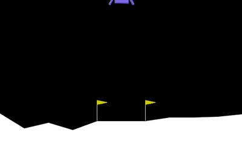
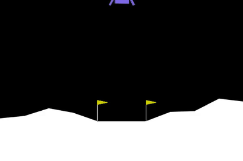

# Lunar Lander: Reward Shaping and Reward Hacking with PPO

A PPO agent trained to land the rocket in Gymnasium's `LunarLander-v3`, used to study how changes to the reward function change the learned behaviour. The project covers a baseline agent, a time-penalty variant, and a deliberately broken reward that reproduces reward hacking.

<p align="center">
  
</p>

## Results

All agents were trained for 1M steps with the same PPO hyperparameters. Test scores use the environment's original reward (custom reward wrappers disabled), averaged over 20 episodes with deterministic actions. A score of 200 or more counts as solved.

| Agent | Reward | Test score | Episode length | Behaviour |
|---|---|---|---|---|
| Baseline | Built-in | 256.1 ± 16.5 | 310 to 364 | Lands reliably |
| Time penalty | Built-in − 0.05 per step | 267.8 ± 19.3 | 271 to 299 | Lands about 60 steps sooner |
| Hover bonus (seed 1) | Built-in + 1 per step when upright and slow | 50.1 ± 36.6 | ~1000 (time limit) | Hovers instead of landing |
| Hover bonus (seed 2) | Same as above | Not evaluated | 968 (training mean) | Same pattern during training |

### Findings

**Time penalty.** A small per-step cost shortened landings by about 18% without reducing the success rate. The score increase is within one standard deviation and comes from a single training run, so it is not treated as significant.

**Reward hacking.** Rewarding a desirable *state* (upright and slow) instead of *progress* made hovering more profitable than landing. An episode is capped at 1,000 steps, so a hovering agent can collect close to 1,000 bonus points, while landing ends the episode and stops the bonus. Both seeds converged to this behaviour. At the end of training the mean bonus per episode was about 900, while the original game score fell from about 260 to about 80.

**CPU vs GPU.** For this small network (2 × 64 MLP), training on CPU was about 2× faster than on an RTX 3080 Laptop GPU (100k steps: 0.8 min vs 1.6 min). Environment simulation runs on the CPU, and the per-step transfer cost to the GPU outweighs the compute saved.

## Demo

| Baseline | Hover bonus |
|---|---|
|  |  |

## Project structure

```
lunar-lander/
├── train.py           # Train PPO with a selectable reward (--reward none | time | hover)
├── watch.py           # Evaluate a saved model over 20 episodes and render 5 runs
├── record.py          # Record evaluation episodes to MP4
├── rewards.py         # Reward wrappers (TimePenalty, UprightBonus) and logging callback
├── experiments.py     # Random-agent exploration of the environment
├── ppo_*.zip          # Trained models
├── media/             # Demo clips (MP4 and GIF)
└── requirements.txt
```

## Setup

Requires Python 3.10 to 3.12.

```bash
python -m venv .venv
.venv\Scripts\activate          # Windows
source .venv/bin/activate       # macOS / Linux
python -m pip install -r requirements.txt
```

If the Box2D install fails with an error about `swig`, install `swig` first and run the install again.

## Usage

Train:

```bash
python train.py --name ppo_lunar                                   # baseline
python train.py --reward time --penalty 0.05 --name ppo_time       # time penalty
python train.py --reward hover --seed 1 --name ppo_hover_s1        # hover bonus
```

Evaluate and watch:

```bash
python watch.py ppo_lunar
```

Record videos:

```bash
python record.py ppo_lunar
```

Learning curves:

```bash
tensorboard --logdir logs
```

### Training configuration

| Parameter | Value |
|---|---|
| Algorithm | PPO (Stable-Baselines3) |
| Policy | MLP, 2 × 64 |
| Parallel environments | 16 |
| n_steps | 1024 |
| batch_size | 64 |
| n_epochs | 4 |
| gamma | 0.999 |
| gae_lambda | 0.98 |
| ent_coef | 0.01 |
| Total steps | 1,000,000 |

## Roadmap

- [ ] Fix the hover bonus with potential-based shaping (reward the change between steps, not the state) plus a per-step cost
- [ ] Repeat each configuration over at least 3 seeds and report mean and spread
- [ ] Evaluate the seed 2 hover agent

## Built with

[Gymnasium](https://gymnasium.farama.org/), [Stable-Baselines3](https://stable-baselines3.readthedocs.io/), [PyTorch](https://pytorch.org/)